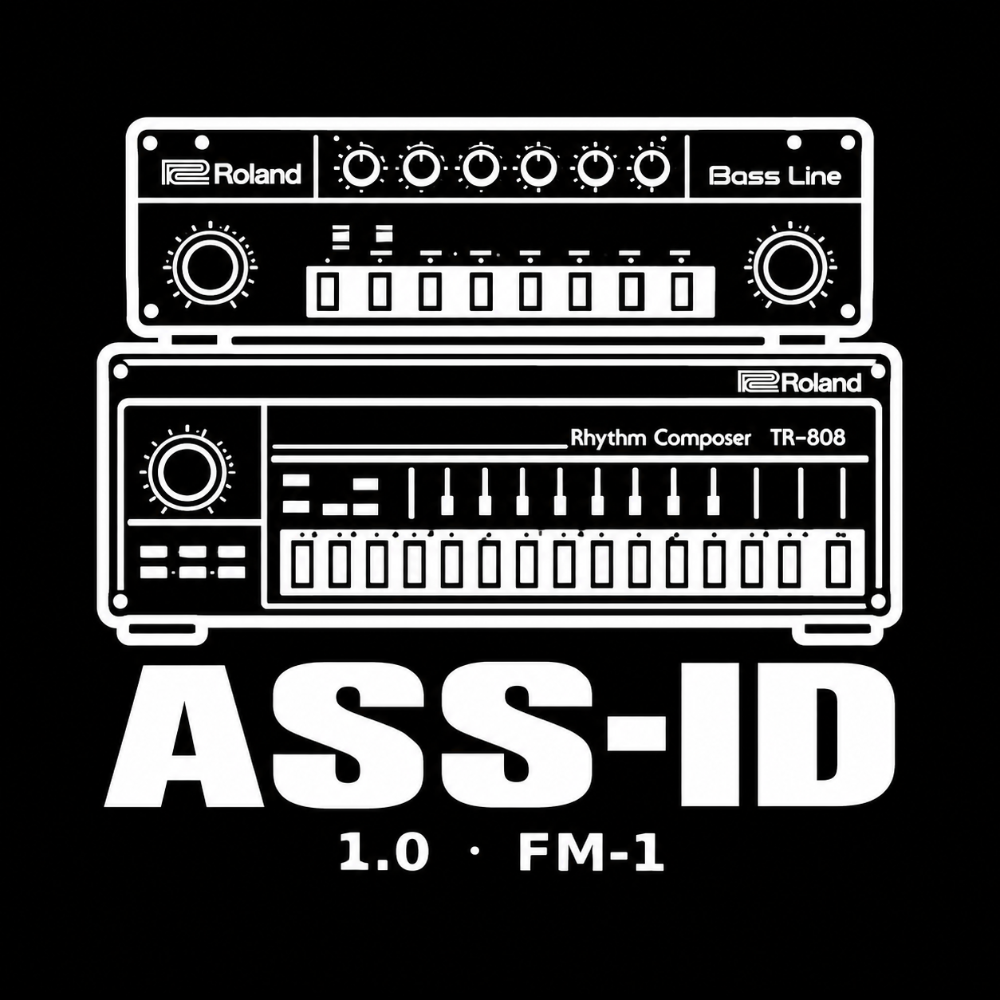
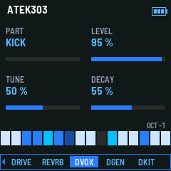
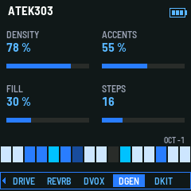
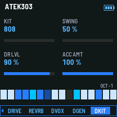
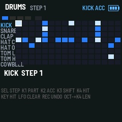

<p align="center">
  
</p>

# ASS-ID 1.0 · FM-1

**Le firmware acid groovebox pour le M-VAVE FM-1** : la piste 303 d'ATEK303,
plus une **piste drum complète TR-808 / 909 / 707**, qui tourne sur le même
principe — générateur à semée, mutations, LOCK, éditeur pas-à-pas — et sur la
même horloge.

Basé sur **ATEK303 1.2** (dépôt [animatek/FM1-Animatek](https://github.com/animatek/FM1-Animatek),
branche taguée `atek303-v1.2`). **GPL-3.0-or-later**, comme l'original.

---

## Qu'est-ce que c'est ?

Le FM-1 devient une petite **groovebox acid autonome** : la piste 303 garde tout
ce qui faisait la 1.2 (14 oscillateurs en WAVE, GLO, effets drive → chorus →
delay → reverb), et une **seconde piste drum** de 64 pas joue avec elle —
commune au tempo, au PLAY, au reloj MIDI. Huit voix de percussion
**synthétisées de toutes pièces** (aucun sample), dans l'esprit des Roland
TR-808, TR-909 et TR-707, et trois kits commutables d'un knob.

Comme la 303 : une semée donne *toujours* le même groove, les mutations la
déplient couche par couche (backbone, tops, accents), **LOCK** fige, **REC**
défait — et les drums vivent dans les presets.

## Ce que ça fait

| | |
| --- | --- |
| **Piste 303** | ATEK303 1.2 entière, inchangée (pages 0-7, HOME, FX) |
| **Piste drum** | 8 voix : KICK, SNARE, CLAP, HAT C, HAT O, TOM L, TOM H, COWBELL (RIMSHOT en kit 707) |
| **Kits** | **808 / 909 / 707** d'un knob (knob KIT, page DKIT) — hats six carrés du 808, bruit filtré en 909/707, clap à trois pré-échecs… |
| **Génération** | semée **DENSITY / ACCENTS / FILL** (page DGEN), même semée = même groove |
| **Mutations** | **ENV** le backbone, **LFO** les tops, **ARP** les accents ; **LOCK** = OCT− + SEQ |
| **Édition** | **matrice 8×16** (EDIT depuis une page drum) : coup, accent, décalage de rangée, undo |
| **Groove** | **SWING** 50-75 % (page DKIT), longueur 1-64 pas indépendante de la 303 |
| **Mix** | bus drum **avant les effets**, niveau **D-LVL**, accents réglables (ACC AMT) |
| **Voix par voix** | LEVEL / TUNE (±12 demi-tons) / DECAY (page DVOX) |
| **Presets** | format compacté **DR64** (320 octets), 8 presets d'usine avec leur groove |
| **MIDI** | notes GM 36-56 des drums en sortie USB ; mute drum = **OCT+ + SEQ** |

## Écouter

Les trois kits, le même groove (moteur seul, sans effets) :

| Kit | Fichier |
| --- | --- |
| TR-808 | [demo/demo_drums_kit808.wav](demo/demo_drums_kit808.wav) |
| TR-909 | [demo/demo_drums_kit909.wav](demo/demo_drums_kit909.wav) |
| TR-707 | [demo/demo_drums_kit707.wav](demo/demo_drums_kit707.wav) |

## Écrans

| DVOX (voix par voix) | DGEN (semée + mutations) |
| --- | --- |
|  |  |
| **DKIT (kit + swing + D-LVL)** | **Matrice 8×16** |
|  |  |

## Prise en main

**PLAY** (les deux pistes) → **SELECT** jusqu'à **DGEN**, **SEQ** tire un autre
groove → **ENV / LFO / ARP** le déplient → **EDIT** pose les coups dans la
matrice → **SELECT** sur **DKIT** pour le kit et le swing → **OCT+ + SEQ**
coupe les drums. **SAVE** comme avant. Le détail de chaque page et de chaque
raccourci : [README-DRUMS.md](README-DRUMS.md).

## Compiler

```sh
git clone https://github.com/altessproduction/ASS-ID_FM1.git
cd ASS-ID_FM1
herramientas/clonar-terceros.sh          # fm1-base dans terceros/ (base/ pointe dessus)
cd atek303
sh build.sh --host                       # le simulateur host
app/build/host/atek303_host app/tests/drums.txt app/build/host      # le test drum (63 vérifs)
sh build.sh                              # le .fwsc (toolchain JieLi requis)
```

La 1.3 a été développée et vérifiée entièrement dans le simulateur host (le
même code que le firmware) : les **8 tests de la 1.2 passent** (basic, clock,
controls, editor, fx, options, presets, steps64), plus
[app/tests/drums.txt](atek303/app/tests/drums.txt) (63 vérifications) et
[atek303/tests/drum_render.c](atek303/tests/drum_render.c) (79 vérifications :
les 24 voix des trois kits sonnent, meurent, pas de NaN, même semée = même
pattern).

**Reste à faire sur le vrai matériel** : compiler le `.fwsc` avec le toolchain
JieLi, mesurer le CPU dans fm1-emu, et régler les derniers gains à l'oreille
(tout est dans des constantes nommées en tête de
[drum_voice.c](atek303/app/dsp/drum_voice.c)). Les presets **AT64 de la 1.2 ne
se chargent pas** — format DR64 oblige ; après un tour de presets sur la
machine, `tools/factory_from_backup.py --magic DR64` reconstruit la table
d'usine.

## Le dépôt

```
atek303/            le firmware complet (source), prêt à compiler
  app/dsp/          moteurs : acid_pattern, atek_voice, drum_voice, drum_pattern, fx
  app/tests/        les suites de tests du simulateur (drums.txt inclus)
  tests/            tests de rendu audio (drum_render.c inclus)
README-DRUMS.md     la piste drum en détail : pages, raccourcis, ce qui a été vérifié
README-ANIMATEK.md  le guide du projet FM1-Animatek (en espagnol) : émulateur, docs, rescousse
CHANGELOG.md        l'historique (entrée 1.3 « DRUMS »)
patch/              le patch git de la 1.3, à appliquer sur le tag atek303-v1.2
demo/               les trois WAV d'écoute (808 / 909 / 707)
docs/screenshots/   les écrans du simulateur
assets/             le logo ASS-ID
```

## Crédits et licence

- **ATEK303** et le projet **FM1-Animatek** : [animatek](https://github.com/animatek/FM1-Animatek)
  (Javier) — le firmware acid d'origine, l'émulateur, toute la documentation.
- **Open303** (Robin Schmidt) : le moteur de la 303, GPL —
  [licence](atek303/app/dsp/LICENSE-open303.txt).
- **[fm1-base](https://github.com/charlesvestal/fm1-base)** (charlesvestal) :
  la couche matérielle du FM-1, MPL-2.0, clonée à part.
- **Piste drum 1.3 et publication ASS-ID** : [altessproduction](https://github.com/altessproduction).

L'ensemble est sous **GPL-3.0-or-later** ([LICENSE](LICENSE)) : vous êtes libres
de l'étudier, le modifier et le redistribuer, à condition de garder la même
licence. Ni le firmware M-VAVE ni les copies de flash n'entrent dans ce dépôt.
